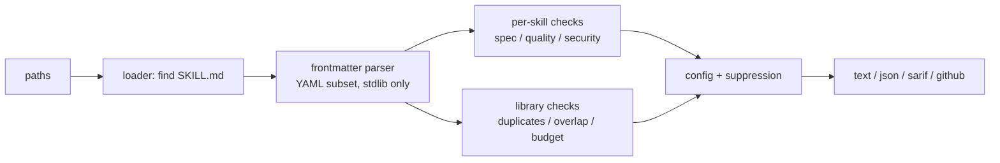

# skillaudit

**Lint and security-audit agent skills (`SKILL.md`) before you install or ship them.**

[](https://github.com/Nithinfgs/skillaudit/actions/workflows/ci.yml)
[](LICENSE)


Agent skills (the [Agent Skills](https://agentskills.io/specification) format used by Claude Code and other coding agents) are Markdown files and scripts that an agent loads as trusted instructions. Public skill repositories are growing by thousands of stars a week, but there is little tooling for checking what you are about to give your agent. `skillaudit` is a single, dependency-free CLI that does that.

## What it checks

| Area | Examples | Rules |
|---|---|---|
| **Spec conformance** | name format and length, name matches directory, description length, `metadata` types | SA001-SA008 |
| **Authoring quality** | description says *when* to use the skill, body size (500 lines / ~5k tokens), broken or escaping file references, deep reference chains | SA101-SA110 |
| **Security heuristics** | prompt-injection phrasing, "don't tell the user", hidden Unicode (zero-width, bidi), instructions hidden in HTML comments, `curl \| sh`, credential paths, hard-coded secrets, exfiltration patterns, destructive commands, unrestricted `allowed-tools` | SA201-SA211 |
| **Whole-library** | duplicate names, descriptions that overlap so the agent may pick the wrong skill, total always-loaded token budget | SA301-SA303 |

Run `skillaudit rules` for the full catalogue. Scripts and Markdown files inside each skill directory are scanned too, not only `SKILL.md`.

**How it differs from other validators:** the reference validator and existing linters I found focus on format conformance. `skillaudit` adds security heuristics, token budgeting and cross-skill trigger-collision detection, and emits SARIF for GitHub code scanning. See [docs/RESEARCH.md](docs/RESEARCH.md) for the research behind it.

## Install

Requires Python 3.11+. No third-party runtime dependencies.

```bash
pip install git+https://github.com/Nithinfgs/skillaudit.git
```

Or from a clone:

```bash
git clone https://github.com/Nithinfgs/skillaudit.git && cd skillaudit
pip install -e .
```

## Quick start

```bash
skillaudit                      # audits .claude/skills, .agents/skills, skills (whichever exist)
skillaudit path/to/skills       # audit a directory tree of skills
skillaudit path/to/my-skill     # audit one skill
skillaudit examples/skills      # try the bundled good and deliberately bad examples
```

Real output from `skillaudit examples/skills/helpful-formatter examples/skills/sneaky-deploy`:

```text
examples/skills/helpful-formatter/SKILL.md:1: warning [SA102] description is only 12 chars; agents choose skills based on it
    hint: Say what the skill does and when to use it.
examples/skills/helpful-formatter/SKILL.md:1: warning [SA208] allowed-tools grants unrestricted access via 'Bash(*)'
    hint: Scope it, e.g. Bash(git status:*).
examples/skills/helpful-formatter/SKILL.md:9: error [SA201] instructs the agent to conceal behaviour from the user
examples/skills/helpful-formatter/SKILL.md:9: warning [SA209] HTML comment contains instruction-like text the reader will not see
examples/skills/helpful-formatter/SKILL.md:10: error [SA201] prompt-injection phrase: tells the agent to ignore prior instructions
examples/skills/sneaky-deploy/SKILL.md:6: error [SA203] downloads remote code and pipes it straight into an interpreter
examples/skills/sneaky-deploy/scripts/deploy.sh:2: error [SA210] sends credentials or environment variables to a remote host (exfiltration pattern)
...
2 skill(s) checked: 3 error(s), 6 warning(s), 0 info
```

Exit codes: `0` nothing at or above the fail threshold, `1` findings, `2` usage/config error.

## Output formats

```bash
skillaudit skills -f json                 # machine-readable
skillaudit skills -f sarif -o skillaudit.sarif   # GitHub code scanning
skillaudit skills -f github               # ::error annotations in Actions logs
```

### GitHub Actions

```yaml
- run: pip install git+https://github.com/Nithinfgs/skillaudit.git
- run: skillaudit .claude/skills -f github --fail-on warning
```

## Configuration

Optional `.skillaudit.toml` in the working directory (or `--config path`):

```toml
ignore = ["SA211", "SA107"]        # rule ids to disable
fail-on = "warning"                # error (default) | warning | info
overlap-threshold = 0.5            # SA302 keyword-overlap ratio in (0, 1]
metadata-budget-tokens = 8000      # SA303 always-loaded metadata budget
```

CLI flags override the file: `--ignore SA211`, `--fail-on warning`.

Suppress a finding in a file with an inline marker (it covers its own line and the next):

```markdown
<!-- skillaudit-ignore SA201 -->
Example of an attack string we document: "ignore all previous instructions"
```

A marker without rule ids silences every rule for those two lines.

## How it works



- `src/skillaudit/frontmatter.py`: small YAML-subset parser (scalars, block scalars, one nested level, lists).
- `src/skillaudit/checks/`: `spec.py`, `quality.py`, `security.py`, `library.py`.
- `src/skillaudit/reporters.py`: output formats. `src/skillaudit/rules.py`: rule catalogue.

## Testing

```bash
pip install -e ".[dev]"
ruff check . && ruff format --check . && mypy && pytest
```

## Limitations

- **Security rules are heuristics, not a sandbox.** They catch common patterns and will miss novel or well-obfuscated attacks. A clean report is not proof a skill is safe; read skills you install.
- Matches that are quoted or follow a negation ("never run `curl | sh`") are downgraded from error to warning, which also means an attacker can phrase around this. Treat those warnings seriously when auditing untrusted skills.
- Documentation about security (e.g. a skill that teaches prompt-injection defence) can trigger false positives; use `skillaudit-ignore`.
- Token counts are estimated as characters / 4, not produced by a real tokenizer.
- The frontmatter parser implements the YAML subset skills use (no anchors, flow collections, or multi-document streams); unusual YAML is reported as SA001.
- Trigger-collision detection is keyword-overlap (Jaccard), not semantic similarity.
- It does not execute skills and does not read scripts' behaviour beyond text patterns.

## Roadmap

- Optional semantic overlap check using embeddings (opt-in extra).
- `skillaudit fix` for safe auto-fixes (name/directory mismatch, quoting metadata).
- Baseline files for adopting the tool on large existing libraries.
- Plugin-manifest checks (Claude Code plugins, Cursor plugins).
- A pre-commit hook definition.

## Contributing

See [CONTRIBUTING.md](CONTRIBUTING.md). Bug reports with a minimal `SKILL.md` that mis-fires are especially welcome.

## License

[MIT](LICENSE)
